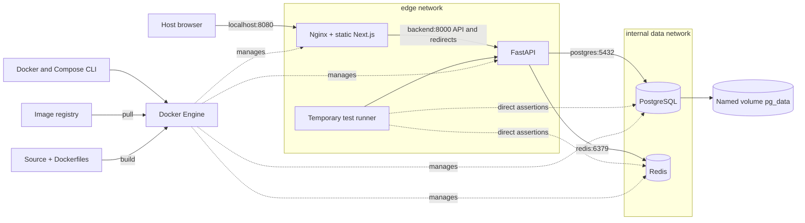

# Docker Seminar: Implementation and Checkpoint Report

This report explains the source code, the demonstrations, and the evidence for
progress from a local URL Shortener to a complete Docker application. The detailed
learning guide is [docker_integration.md](../docker_integration.md).

## Source checkpoints

| Phase | Git tag | What the checkpoint demonstrates |
|---|---|---|
| 00 | `seminar/00-local` | Working local application and HTTP smoke tests |
| 01 | `seminar/01-problem` | Missing dependencies in an empty Python environment |
| 02 | `seminar/02-concepts` | Images, containers, and process lifecycle |
| 03 | `seminar/03-image` | Build and run the backend image |
| 04 | `seminar/04-ports` | Publish the container port to the host |
| 05 | `seminar/05-registry-db` | Pull PostgreSQL and initialize its schema |
| 06 | `seminar/06-network` | Resolve container names on a user-defined network |
| 07 | `seminar/07-volume` | Preserve data across database container replacement |
| 08 | `seminar/08-compose` | Orchestrate frontend, backend, and PostgreSQL |
| 09 | `seminar/09-redis` | Verify cache behavior, fallback, and section 9.6 |
| 10 | `seminar/10-architecture` | Architecture inspection, real integration tests, and CI |

Git tags identify source snapshots; Docker image tags identify packaged artifacts.
Existing source tags 00-08 are retained. Phase 9 extends the existing Redis commit.
Tags are created only after their corresponding checks pass.

## Phase 00: Local baseline

The local system uses Next.js, FastAPI, and PostgreSQL. Disable the optional cache
with `REDIS_URL=` in `backend/.env`. Use `backend/.venv` explicitly; packages in
another interpreter do not become available in this environment.

| Request | Meaning | Expected status |
|---|---|---|
| `POST /api/urls` | Create a random or custom short code | 201 |
| `GET /api/urls?limit=20&offset=0` | List records | 200 |
| `GET /{short_code}` | Redirect an active link | 302 + Location |
| `DELETE /api/urls/{short_code}` | Delete a mapping | 204 |
| `GET /{deleted_code}` | Resolve an absent mapping | 404 |
| `GET /{expired_code}` | Resolve an expired mapping | 410 |
| `GET /app/health` | API process liveness | 200 |

`app/db/init_db.py` creates missing tables; it does not migrate existing tables.
`tests/smoke_api.py` uses the standard library to test a running HTTP server. It
disables redirect following so the assertion sees the backend's 302, rather than
the external destination's status. Each run deletes its own test records.
The health endpoint does not query PostgreSQL or Redis: a 200 proves liveness,
not end-to-end readiness.

## Phase 01: Reproduce the environment problem

Create an empty environment with `python -m venv .venv-empty`, then run that
interpreter with `-m uvicorn app.main:app`. The expected failure is `No module
named uvicorn`. Calling an unqualified `uvicorn` executable could accidentally
use a working installation from PATH and spoil the demonstration.
Docker packages the runtime and dependencies; it does not automatically repair
invalid configuration, schemas, or application logic.

## Phase 02: Images, containers, and lifecycle

An image contains filesystem layers and execution metadata. A container is an
instance created from an image, with its own writable layer. An Alpine container
running a short command exits when its main process finishes. `docker ps -a`
shows stopped containers, while `docker ps` shows running containers.

Demonstrate `logs`, `inspect`, `start`, `stop`, and `rm`. Removing a container does
not remove its image. Linux containers share the container host's kernel, whereas
a VM has a guest kernel. Docker Desktop hosts Linux containers in a Linux VM on
Windows; a container is not itself a complete VM.

## Phase 03: Package the backend

[`backend/Dockerfile`](../backend/Dockerfile) starts from Python 3.12 slim, sets
`/app` as the working directory, and copies the dependency lock before source.
This ordering lets source-only edits reuse the dependency layer. The BuildKit pip
cache mount accelerates downloads; it is separate from runtime data storage.

`--require-hashes --only-binary=:all:` checks locked Python packages and avoids
building source distributions. `.dockerignore` excludes `.env*`, virtual
environments, caches, and Git metadata. It must not exclude `tests/`: the `test`
stage needs to copy that directory. The final `runtime` stage copies only app code,
creates UID 10001, and starts Uvicorn without root or `--reload`.

Uvicorn binds to `0.0.0.0:8000`. `EXPOSE 8000` is metadata and does not publish a
host port. The manual-demo environment uses `host.docker.internal` to address a
host database on Docker Desktop. The network phase replaces it with `seminar-pg`.

## Phase 04: Port mapping

`-p 127.0.0.1:8001:8000` maps host port 8001 to container port 8000. A container
must be recreated to change published ports; `stop` and `start` retain its original
configuration. Verify `docker port` and `/app/health`, then test CRUD separately:
liveness does not guarantee a working database connection.

## Phase 05: Registry and PostgreSQL

Docker Hub distributes images, not running containers or database volumes.
`docker pull postgres:17-alpine` downloads an image; `docker run` creates a container.
Registry login and push remain optional manual exercises; no script publishes
images or deploys the application automatically.

[`docker/postgres/init.sql`](../docker/postgres/init.sql) defines the UUID primary
key, unique short code, original URL, zero-default counter, and `TIMESTAMPTZ`
columns. The application generates UUIDs. Mount this SQL file read-only under
`/docker-entrypoint-initdb.d/`. Initialization scripts and `POSTGRES_*` initialization
settings apply only to an empty data directory. Changing the password environment
variable does not update an existing cluster; changing init.sql is not a migration.

Wait for TCP `pg_isready -h 127.0.0.1` before querying the final PostgreSQL server.
Manual containers use host port 5433 to avoid a local PostgreSQL on 5432.

## Phase 06: Container networking

Create `seminar-net`, a user-defined bridge, and attach the backend and database.
Docker DNS resolves `seminar-pg`; the backend connects to `seminar-pg:5432`.
`localhost` inside the backend means the backend container itself. Containers
communicate over their shared network, not through each other's localhost.

A published database port is unnecessary for container-to-container traffic.
Verify DNS resolution, a real SQL connection, and HTTP CRUD separately. DNS alone
does not verify credentials or the schema.

## Phase 07: Persistent storage

PostgreSQL 17 stores this demo's cluster at `/var/lib/postgresql/data`. Its image
can create an anonymous volume when no named mount is supplied. Removing the
container with `docker rm -v` removes that anonymous data. Do not describe all
PostgreSQL files as living only in the container writable layer.

Mount `seminar-pg-data`, insert a recognizable marker, remove the database
container, recreate it with the same named volume, and query the marker again.
Container replacement is stronger evidence than a plain restart.

The SQL bind mount holds configuration; the named volume holds live data. A volume
is not a backup. Use `pg_dump -f /tmp/seminar.sql` and `docker cp` for an independent
file, avoiding native-output redirection encoding problems in Windows PowerShell.
A restore procedure still needs its own rehearsal.

## Phase 08: Compose and frontend

[`compose.yaml`](../compose.yaml) declares services, networks, a named volume, and
health checks. Compose sends requests to Docker Engine; it is not a runtime server
between the browser and the application.

The frontend builds static Next.js output using Node 22 and `npm ci --ignore-scripts`.
Nginx serves `/app/out` on port 8080. `.env*` is excluded from its build context, so
the API helper uses its empty-base default: the browser's current origin. Browser
code must not use the Docker hostname `backend`.

`frontend/nginx.conf` serves static resources first, proxies `/api/` and health,
and sends unknown paths such as `/{code}` to FastAPI. Docker's DNS resolver at
`127.0.0.11`, together with a variable upstream, lets Nginx resolve a replacement
backend. The Nginx image uses its default root master process; only the backend
explicitly runs as non-root. Do not claim that every service runs without root.

Only the frontend publishes a host port. Frontend and backend share `edge`;
backend, PostgreSQL, and Redis share the internal `data` network. The optional
`tests` runner joins both networks for direct SQL/cache assertions. It exits after
testing and is not a fifth permanent application service.

`depends_on: condition: service_healthy` controls startup ordering. It does not
continuously restart dependents after a dependency fails. Integration tests remain
necessary because backend health is liveness only.

`SEMINAR_HTTP_PORT` defaults to 8080 and permits an isolated rehearsal on another
port. A separate project name creates separate networks and database volumes.
Application image tags are shared; rebuilding a tag does not replace existing
containers in other projects.

## Phase 09: Redis and section 9.6

Redis 8 stores disposable `url:{code}` destination keys. Snapshots and AOF are
disabled; it has no persistent volume or host port. PostgreSQL remains the source
of truth. `cache_service.py` sets one-second connect/read timeouts and catches
Redis errors so the database path remains available.

Socket timeouts do not bound hostname resolution. During rehearsal, a stopped
Redis container caused slow DNS resolution and an HTTP test timeout. The backend
and test service now set resolver options `timeout:1` and `attempts:1`. With those
options, the real outage test completed successfully. This is not a hard
one-second end-to-end deadline; resolution, connect, and read are separate costs.

### Explain the code

`app/api/redirect.py` calls `url_service.resolve_short_code`. On a cache MISS, a
guarded SQL `UPDATE ... WHERE expires_at > now RETURNING ...` increments clicks
and retrieves the current mapping atomically. The service commits before writing
Redis. TTL is capped by both the configured limit and the remaining URL lifetime;
nonpositive TTL skips the write.

On a HIT, SQL still checks the destination and expiration while incrementing the
counter. A stale destination is invalidated and resolved from PostgreSQL. A HIT
therefore still touches the database. Redis cannot keep redirects available if
PostgreSQL fails, and this demo does not establish a performance improvement.

`DELETE /api/urls/{code}` commits deletion before invalidating Redis. The next
`GET /{code}` returns 404. `DELETE /{code}` is incorrect. Expired links return 410
without incrementing clicks, even if a stale cache entry exists. Only successful
302 redirects count as clicks. A 410 during a Redis outage is expiration evidence,
not evidence of broken Redis fallback.

### Demonstrate and assert

`scripts/seminar/09-redis.ps1` pauses before every step. Section 9.6 begins at step
5. Deletion and expiration steps create independent records. The expiration step
creates and warms an eight-second URL without a presentation pause in between.
The fallback step creates a fresh one-day URL and restores Redis in `finally`.

`tests/docker_cache.py` runs against real PostgreSQL and Redis. Its normal suite
checks MISS/HIT, exact counters, deletion invalidation, expiration, and stale cache
repair. The `--fallback` suite verifies redirects, counters, and deletion while
Redis is stopped. Use `run --no-deps`: starting dependencies during this test could
restart Redis and invalidate the experiment. Tests only remove their own records
and keys; they do not issue `FLUSHALL`.

## Phase 10: Architecture and CI

The browser receives a 302 Location and visits the destination itself. The backend
does not fetch that website. Compose declares and manages infrastructure through
the Engine; neither Compose nor the registry handles redirect requests.

`10-architecture.ps1` inspects networks, volume, and published ports; runs the same
HTTP smoke suite directly against FastAPI and through Nginx; then runs real cache
checks. These are different paths through the same system, not different business
test cases. A static-page assertion also detects a broken frontend image copy.

`.github/workflows/ci.yml` retains SQLite backend tests, Node helper tests, the
static build, and browser tests with intercepted APIs. The pip command now uses
a YAML folded scalar: the colon followed by whitespace in `--only-binary=:all:`
made the original plain scalar invalid YAML. Dependency versions and hashes have
not been loosened.

`.github/workflows/docker-smoke.yml` adds real PostgreSQL/Redis integration in a
fresh runner. It validates Compose, builds and waits, builds the test target,
checks static serving, tests both HTTP paths, checks Redis, stops Redis for the
outage test, and restores it with a shell trap. All test containers use `--rm` and
the outage test uses `--no-deps`. Logs and cleanup execute even after failure.
Deleting CI volumes is appropriate for that isolated disposable job, not normal
operation of a database containing user data. The workflow does not publish or deploy.

The live browser test can now target Docker without editing source: set
`PLAYWRIGHT_LIVE_BASE_URL` and `PLAYWRIGHT_LIVE_API_URL` to the Nginx origin and use
`playwright.live.config.mjs`. Defaults retain the local ports 3000 and 8000.
This test uses actual browser form submission and a real API/database; redirect
and deletion assertions use Playwright's HTTP client without following redirects.

### Applied practices and limits

| Context | Benefit | Responsibility still required |
|---|---|---|
| Development | Consistent runtime, database and cache | Environment values and hot reload strategy |
| Testing | Repeatable services and real integration paths | Independent data, useful assertions |
| CI/CD | Build and test before distribution | Secrets, registry permissions and rollout policy |
| Deployment | Reusable image artifact | TLS, migrations, backups, monitoring and capacity |

Dependency-first copies and BuildKit caches reduce rebuild work. Multi-stage
frontend builds omit Node from runtime, and backend runtime omits test code.
Only the necessary entry port is published. Database data uses a named volume,
and Redis is disposable. Logs go to stdout/stderr. No rate limiter, account system,
queue, or orchestration platform has been added to this small seminar application.

Base image tags remain mutable and are not digest-pinned, so rebuilding an old
source tag is not a guarantee of byte-identical artifacts. The demo has no TLS,
high availability, backup restore automation, migration framework, or production
resource sizing. These are stated limits, not claims that Docker supplies them.

## Official references

- [Compose startup ordering](https://docs.docker.com/compose/how-tos/startup-order/)
- [Compose services](https://docs.docker.com/reference/compose-file/services/)
- [PostgreSQL image](https://hub.docker.com/_/postgres)
- [Build cache](https://docs.docker.com/build/cache/optimize/)
- [Volumes](https://docs.docker.com/engine/storage/volumes/)

## Verification record

Verified on Windows PowerShell 5.1 with Docker Desktop on 17 November 2026. The
Compose project `url-shortener-verify` uses port 18080 and a separate database
volume. The existing `url-shortener-seminar` stack and its stored data are retained.

| Check | Observed result |
|---|---|
| Backend `pytest -q`, from `backend/` | 54 passed; existing httpx deprecation warning |
| Runtime and frontend image builds | Passed, including the Next.js production build |
| Compose configuration and startup | Passed; all four services healthy |
| Phase 9 step 2 through step 7 | Passed with real HTTP, SQL and cache assertions |
| Real cache suite | 3 passed: MISS/HIT/delete, expiration, stale destination |
| Real Redis outage suite | 1 passed; redirects and clicks work while Redis is stopped |
| HTTP smoke suite through Nginx | 2 passed: CRUD/redirect/clicks and expiration |
| Phase 10 script | Passed all five steps; direct backend and proxied smoke paths |
| Live Playwright through Nginx | 1 passed using the real Docker API and database |
| Frontend helper and browser regression | 3 Node tests and 18 intercepted-API browser tests passed |
| GitHub Actions syntax | Both workflows passed actionlint 1.7.7 |

These results do not prove a performance gain or production readiness. A CI
workflow must run on its remote runner before its hosted result can be reported.
